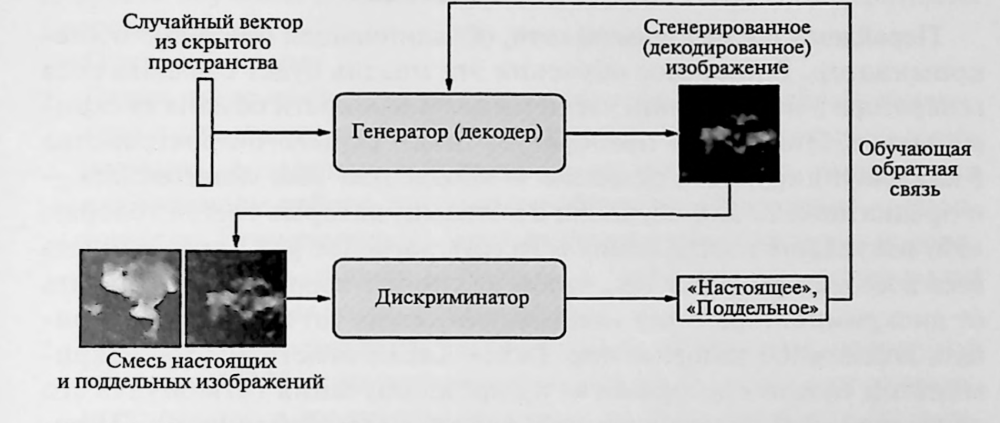
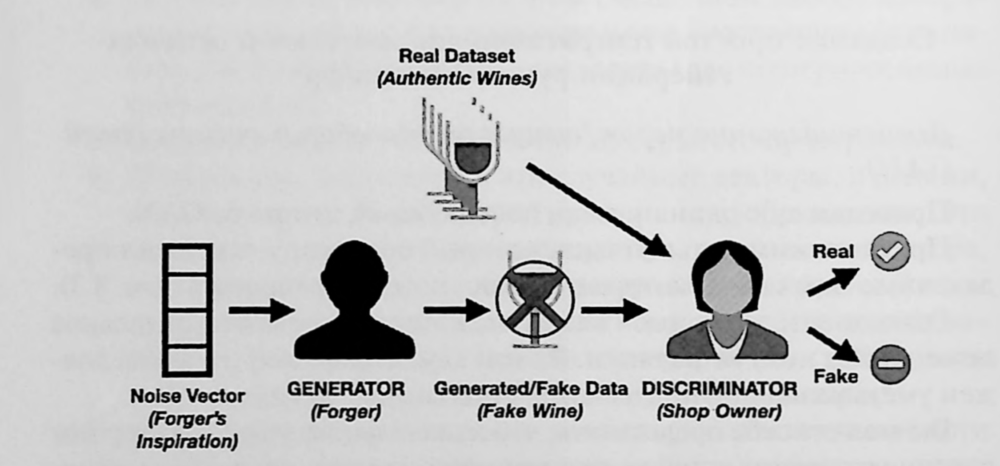

# Лабораторная работа «Генеративно-состязательные сети»

Эта работа переводит идею состязательного обучения в воспроизводимый
эксперимент. Результатом будет не классификатор, а генератор новых
изображений, который получает случайный вектор и постепенно учится создавать
правдоподобные цифры, предметы одежды и лица. Работа начинается с плоских
изображений $28\times28$, а затем переносит те же состязательные принципы на
цветные лица $64\times64$. Перед началом работы последовательно прочитайте
включённый файл «lecture_gan_excerpt.pdf».

# Этап 1. Цель, результат и порядок прохождения

Цель — вручную собрать две взаимодействующие нейронные сети: генератор
$G_{\theta}$ и дискриминатор $D_{\phi}$. В отличие от обычной модели с одной
функцией потерь, эти сети имеют разные, конкурирующие цели. Генератор
превращает шум в изображение, а дискриминатор отличает настоящие изображения
набора от синтетических.

Выполняйте ноутбуки сверху вниз. Сначала изучите завершённый пример на MNIST,
затем реализуйте самостоятельный вариант на Fashion-MNIST. После этого
перейдите к лицевым изображениям: изучите сравнение dense GAN и DCGAN на LFW
в TensorFlow или PyTorch, затем самостоятельно реализуйте DCGAN на Olivetti
Faces. Во всех этапах
фиксируйте четыре вещи: входные данные, форму тензоров, выполняемое
преобразование и наблюдаемую проверку результата.

После выполнения работы студент должен уметь:

- различать генератор, дискриминатор, логит и вероятность «настоящего»
  изображения;
- формировать реальные изображения и шумовые векторы одного мини-пакета;
- реализовывать попеременные шаги обновления двух наборов параметров;
- объяснять, почему при шаге генератора дискриминатор передаёт градиент, но не
  обновляется;
- интерпретировать две кривые потерь и сетки сгенерированных изображений;
- переносить постановку с MNIST на Fashion-MNIST.
- объяснять, почему представление лица как плоского вектора отличается от
  обработки пространственной RGB-карты свёрточной сетью;
- выбирать CPU или Intel Arc XPU для PyTorch-эксперимента и проверять, что
  выбранное устройство действительно используется.

# Этап 2. Математическая постановка GAN

Пусть $B$ — размер мини-пакета, $d_z=100$ — размерность шумового пространства,
а $d_x=784=28\cdot28$ — число пикселей одного изображения после развёртывания
в строку. На вход генератору поступает мини-пакет независимых случайных
векторов:

\begin{equation}
\mathbf Z=(\mathbf z^{(1)},\ldots,\mathbf z^{(B)})^{\mathsf T}
\in\mathbb R^{B\times100},
\qquad z^{(i)}_r\sim\mathcal N(0,1).
\label{eq:gan-noise}
\end{equation}

Каждая строка $\mathbf z^{(i)}$ — не метка и не скрытое состояние настоящего
изображения, а источник случайной вариации. Генератор выдаёт плоское
изображение:

\begin{equation}
\tilde{\mathbf X}=G_{\theta}(\mathbf Z)
\in[-1,1]^{B\times784}.
\label{eq:gan-generator-output}
\end{equation}

Строку $\tilde{\mathbf x}^{(i)}$ можно вернуть к форме
$(28,28,1)$ только для отображения. Для вычислений дискриминатору достаточно
формы $(B,784)$.

{#fig:gan-architecture}

На рис. \ref{fig:gan-architecture} показаны оба информационных потока.
Настоящие изображения поступают только в дискриминатор. Генератор не получает
их как прямой вход: его сигнал об ошибке проходит через ответ дискриминатора.

Дискриминатор возвращает одну вероятность для каждого изображения:

\begin{equation}
D_{\phi}(\mathbf X)\in(0,1)^{B\times1}.
\label{eq:gan-discriminator-output}
\end{equation}

Значение близкое к $1$ означает «похоже на настоящее», близкое к $0$ —
«похоже на синтетическое». Это именно вероятность после sigmoid; логит —
неограниченная вещественная величина до sigmoid.

# Этап 3. Среда, данные и нормализация

Работа выполняется на Python 3.13, TensorFlow 2.21 и CPU. В начале ноутбука
фиксируются генераторы случайных чисел и константы. Полный пример берёт первые
$10\,000$ изображений MNIST, самостоятельная работа — первые $10\,000$
изображений Fashion-MNIST. Наборы различны, поэтому самостоятельный вариант
проверяет перенос алгоритма на новые данные.

Исходное изображение имеет тип целого числа и пиксели из диапазона
$[0,255]$. Генератор завершает работу функцией $\tanh$, поэтому реальные
изображения приводят к тому же диапазону:

\begin{equation}
\mathbf x_{\mathrm{scaled}}
=\frac{\mathbf x-127.5}{127.5}\in[-1,1]^{784}.
\label{eq:gan-normalization}
\end{equation}

**Вход этапа** — изображения формы $(N,28,28)$.
**Действие** — привести их к типу «float32», применить
\eqref{eq:gan-normalization} и развернуть каждое в строку.
**Выход** — матрица $\mathbf X_{\mathrm{real}}\in[-1,1]^{N\times784}$.
**Проверка** — минимальное и максимальное значения принадлежат $[-1,1]$, а
первый мини-пакет имеет форму $(B,784)$.

Метки MNIST и Fashion-MNIST не подаются в генератор, дискриминатор или функцию
потерь. Они могут использоваться только для подписи исходных картинок при
визуальной проверке: GAN учится без меток классов.

# Этап 4. Архитектура генератора

Генератор имеет последовательность полносвязных слоёв

\begin{equation}
100\longrightarrow256\longrightarrow512\longrightarrow1024
\longrightarrow784.
\label{eq:gan-generator-architecture}
\end{equation}

После первых трёх линейных преобразований применяется LeakyReLU. Последний
слой использует $\tanh$, поэтому его выход уже согласован с диапазоном
\eqref{eq:gan-normalization}. Вход одного объекта имеет форму $(100)$,
выход — $(784)$; для мини-пакета добавляется первая ось $B$.

**Что реализовать.** Создайте объект «keras.Sequential» или эквивалентную
модель с указанными размерностями, инициализацией
«RandomNormal(stddev=0.02)» и LeakyReLU с отрицательным наклоном $0.2$.
Выполните диагностический проход на $\mathbf Z$ из \eqref{eq:gan-noise}.
**Контрольная точка** — форма результата $(B,784)$, все значения конечны и
лежат в диапазоне $[-1,1]$.

# Этап 5. Архитектура дискриминатора

Дискриминатор имеет обратную по ширине последовательность:

\begin{equation}
784\longrightarrow1024\longrightarrow512\longrightarrow256
\longrightarrow1.
\label{eq:gan-discriminator-architecture}
\end{equation}

После трёх скрытых слоёв используются LeakyReLU и Dropout с вероятностью
$0.3$. Dropout активен только при «training=True»: в этом режиме он случайно
исключает часть признаков и не позволяет дискриминатору слишком быстро
запомнить малую выборку. Последний sigmoid переводит единственный логит в
вероятность из \eqref{eq:gan-discriminator-output}.

**Вход этапа** — реальные или сгенерированные строки $(B,784)$.
**Выход** — столбец вероятностей $(B,1)$. **Типичная ошибка** — передать
дискриминатору неразвёрнутую форму $(B,28,28)$ или сравнить его вероятности с
метками классов данных. Его цель — только «настоящее / синтетическое».

# Этап 6. Бинарная кросс-энтропия и цели сторон

Для одной вероятности $p$ и целевой величины $y\in[0,1]$ бинарная
кросс-энтропия равна

\begin{equation}
\operatorname{BCE}(y,p)=-y\log p-(1-y)\log(1-p).
\label{eq:gan-bce}
\end{equation}

Если $y=1$, малая потеря получается при $p$ близком к единице; если $y=0$ —
при $p$ близком к нулю. В этой работе дискриминатор получает настоящие
изображения с мягкой целевой меткой $0.9$, а синтетические — с меткой $0$:

\begin{equation}
\mathcal L_D=
\frac{1}{2}\operatorname{BCE}(\mathbf {0.9},D_\phi(\mathbf X_{\mathrm{real}}))
+\frac{1}{2}\operatorname{BCE}(\mathbf 0,D_\phi(G_\theta(\mathbf Z))).
\label{eq:gan-discriminator-loss}
\end{equation}

Мягкая метка $0.9$ вместо $1$ называется односторонним сглаживанием меток. Она
не даёт дискриминатору стремиться к чрезмерно уверенным ответам на реальные
примеры и обычно делает состязательный процесс устойчивее.

Генератор использует несатурирующую цель:

\begin{equation}
\mathcal L_G=\operatorname{BCE}(\mathbf 1,
D_\phi(G_\theta(\mathbf Z))).
\label{eq:gan-generator-loss}
\end{equation}

Здесь изображения остаются синтетическими, но целевая метка $1$ выражает
желание генератора добиться высокой оценки «настоящее». Вход
\eqref{eq:gan-generator-loss} — новый шумовой мини-пакет; выход — один
скаляр, по которому обновляются только $\theta$. Дискриминатор участвует в
вычислении производной как фиксированная дифференцируемая функция, поэтому
градиент проходит через него к генератору, но параметры $\phi$ на этом шаге
не изменяются.

# Этап 7. Попеременный шаг обучения

{#fig:gan-workflow}

Рисунок \ref{fig:gan-workflow} помогает отделить два шага одной итерации.
Они всегда выполняются в следующем порядке.

1. Выберите реальный мини-пакет $\mathbf X_{\mathrm{real}}$ и сгенерируйте
   независимый шум $\mathbf Z$.
2. Получите $G_\theta(\mathbf Z)$ и вычислите
   \eqref{eq:gan-discriminator-loss}. Градиентный шаг применяют только к
   переменным дискриминатора $\phi$; генератор в этот момент не обновляется.
3. Сгенерируйте новый $\mathbf Z$, вычислите
   \eqref{eq:gan-generator-loss}. На этом шаге применяют градиент только к
   параметрам генератора $\theta$; переменные дискриминатора не обновляются.
4. Сохраните средние $\mathcal L_D$ и $\mathcal L_G$ за эпоху и периодически
   визуализируйте фиксированный набор из 100 шумовых векторов.

В современном TensorFlow это делается двумя блоками «tf.GradientTape» и двумя
экземплярами Adam с «learning_rate=0.0002», «beta_1=0.5». Аргумент
«training=True» включается в шаге дискриминатора, чтобы Dropout регуляризовал
обучение. При шаге генератора дискриминатор вызывается с «training=False»;
это фиксирует его поведение Dropout и, вместе с применением градиентов только к
переменным генератора, реализует требуемое замораживание.

# Этап 8. Оценка и признаки неустойчивости

GAN не имеет единственной численной метрики качества, аналогичной точности
классификатора. Поэтому фиксируйте одновременно:

- средние за эпоху $\mathcal L_D$ и $\mathcal L_G$;
- сетки из 100 изображений после первой эпохи, далее через равные интервалы и
  в конце обучения;
- разнообразие изображений и наличие различимых контуров;
- признаки коллапса мод: генератор выдаёт почти одинаковые образцы для
  разных шумовых векторов;
- признаки доминирования дискриминатора: его потеря почти нулевая, а
  генератор не получает полезного сигнала.

Потери GAN не обязаны монотонно убывать: каждая сторона изменяет задачу другой.
Успех учебного запуска — не идеальные изображения, а конечные значения потерь,
корректные формы, видимое улучшение сеток и содержательная интерпретация
наблюдаемой динамики.

# Этап 9. Генерация лиц: от dense GAN к RGB DCGAN

Плоская архитектура из предыдущих этапов уместна для небольших
$28\times28$-изображений, но она не использует тот факт, что соседние пиксели
лица образуют контуры глаз, носа, губ и границ освещения. Для цветного лица
размером $64\times64$ число значений уже равно
$64\cdot64\cdot3=12\,288$. Если подать их в dense GAN одной длинной строкой,
полносвязный слой не знает, какие компоненты были соседними пикселями. DCGAN
оставляет изображение трёхмерной картой и применяет одинаковое небольшое ядро
во многих положениях. Такое разделение весов уменьшает число независимых
параметров и вводит полезное предположение о повторяемости локальных признаков.

В новых подробных примерах две архитектуры обучаются на одном и том же срезе
цветного LFW. Самостоятельные варианты используют Olivetti Faces. Это два
разных набора: LFW содержит разнообразные цветные фотографии лиц, а Olivetti
Faces — небольшой набор из 400 чёрно-белых лиц $64\times64$. В Olivetti один
серый канал повторяется три раза, чтобы модель имела форму RGB-входа; это не
добавляет изображению цветовых сведений.

| Учебный маршрут | Среда | Данные | Роль |
|---|---|---|---|
| TensorFlow: пример | CPU | LFW | Сравнение dense GAN и RGB DCGAN |
| TensorFlow: самостоятельная работа | CPU | Olivetti Faces | Реализация RGB DCGAN |
| PyTorch: пример | Intel Arc XPU или CPU | LFW | Сравнение dense GAN и RGB DCGAN |
| PyTorch: самостоятельная работа | Intel Arc XPU или CPU | Olivetti Faces | Реализация RGB DCGAN |

Точные имена файлов:

- `03_face_gan_tensorflow_example.ipynb`;
- `04_face_gan_tensorflow_assignment.ipynb`;
- `05_face_gan_pytorch_example.ipynb`;
- `06_face_gan_pytorch_assignment.ipynb`.

Метки персон в обоих наборах — служебные идентификаторы исходных записей. Они
не являются входом генератора, целью дискриминатора или критерием качества.
Не делайте выводов о личности, возрасте, поле и других характеристиках людей
по реальным либо синтезированным изображениям: эти данные используются только
для учебной генерации визуальных образцов.

## Этап 9.1. Входы, выходы и нормализация лицевого эксперимента

Пусть $B$ — размер мини-пакета. Генератор получает те же независимые шумовые
векторы, что и в формуле \eqref{eq:gan-noise}, но теперь возвращает
не плоскую строку, а RGB-карту:

\begin{equation}
\mathbf Z\in\mathbb R^{B\times100},\qquad
G_\theta(\mathbf Z)\in[-1,1]^{B\times64\times64\times3},\qquad
S_\phi(\mathbf X)\in\mathbb R^{B\times1}.
\label{eq:gan-face-forms}
\end{equation}

Здесь $S_\phi$ — выход дискриминатора **до** sigmoid, то есть столбец
логитов. В TensorFlow RGB-пакет имеет порядок осей `(B,64,64,3)`, а в PyTorch
— `(B,3,64,64)`; это одно и то же математическое изображение при разном
порядке хранения каналов. Реальные пиксели сначала приводятся к $[0,1]$, а
затем к $[-1,1]$:

\begin{equation}
\mathbf X_{\mathrm{real}}=2\mathbf X_{[0,1]}-1.
\label{eq:gan-face-normalization}
\end{equation}

**Вход этапа** — массив лиц и шум, определённый формулой
\eqref{eq:gan-face-forms}. **Выход**
— реальные и синтетические тензоры полностью одинаковой формы и диапазона.
Это обязательное условие: иначе дискриминатор сможет распознавать источник по
техническому масштабу данных, а не по содержанию изображения.

## Этап 9.2. Логиты и устойчивый вариант BCE

Для лицевых моделей дискриминатор намеренно не содержит завершающего sigmoid.
Пусть $s$ — его логит, а $p=\sigma(s)$ — вероятность «настоящее». Вместо
отдельного вычисления $p$ и формулы \eqref{eq:gan-bce} используется
численно устойчивая функция `BCEWithLogits` / `BinaryCrossentropy` с
`from_logits=True`:

\begin{equation}
\operatorname{BCELogits}(y,s)
=-y\log\sigma(s)-(1-y)\log(1-\sigma(s)).
\label{eq:gan-bce-logits}
\end{equation}

Она математически равна BCE после sigmoid, но вычисляется без потери точности
при больших по модулю логитах. Цели сторон остаются прежними:

\begin{equation}
\mathcal L_D=\frac{1}{2}\operatorname{BCELogits}(0.9,S_\phi(\mathbf X_{\mathrm{real}}))
+\frac{1}{2}\operatorname{BCELogits}(0,S_\phi(G_\theta(\mathbf Z))),
\qquad
\mathcal L_G=\operatorname{BCELogits}(1,S_\phi(G_\theta(\mathbf Z))).
\label{eq:gan-face-objectives}
\end{equation}

При вычислении $\mathcal L_D$ синтетические лица отсоединяются от графа
генератора: обновляются только $\phi$. При вычислении $\mathcal L_G$ параметры
$\phi$ не обновляются, но операция $S_\phi$ остаётся дифференцируемой, поэтому
производная от потери проходит к $\theta$. Это не два разных набора данных, а
два разных направления оптимизации одной состязательной игры.

## Этап 9.3. Dense GAN и DCGAN как сравниваемые предположения

Dense GAN разворачивает карту в вектор из $12\,288$ компонент. Его генератор
выполняет схему $100\to1024\to2048\to12\,288$, а дискриминатор — обратную
последовательность после операции `Flatten`. DCGAN начинает с маленькой карты
$4\times4\times512$ и четыре раза увеличивает пространственное разрешение
транспонированной свёрткой до $64\times64\times3$. Дискриминатор DCGAN четыре
раза уменьшает разрешение свёрткой со stride 2, затем преобразует признаки в
один логит.

Сравнение в примерах честно только потому, что набор лиц, шумовая размерность,
скорость обучения и число эпох одинаковы. Сопоставляйте одновременно число
параметров, время, сетки фиксированных шумовых векторов, разнообразие лиц и
две кривые потерь. Меньшая потеря одной стороны сама по себе не доказывает
лучшее качество: она зависит от текущей силы противоположного игрока.

## Этап 9.4. CPU и Intel Arc XPU

TensorFlow-пример использует CPU-профиль: 2 500 лиц LFW, 80 эпох, пакет 32.
Этот профиль обычно занимает около двух с половиной часов: dense GAN нужен
как сравнительная базовая линия, а от DCGAN ожидается более связная
пространственная структура лиц. Нормированный LFW уже имеет диапазон
$[0,1]$; перед обучением он преобразуется формулой $2X-1$ в $[-1,1]$.
В PyTorch сначала проверяется `torch.xpu.is_available()`. При успехе выбирается
Intel Arc и полный профиль: 8 000 лиц, 120 эпох, пакет 128. При отсутствии
XPU автоматически выбирается CPU-профиль. После запуска обязательно
зафиксируйте в отчёте фактическое устройство, размер выборки, число эпох и
длительность обучения.

**Контрольная точка:** активное устройство явно печатается в первой ячейке,
а все параметры модели и тензоры обучающего пакета находятся на одном
устройстве. Для Arc требуется отдельная среда `.venv-xpu`, создаваемая
сценарием `setup-pytorch-xpu.sh`.

# Этап 10. Самостоятельный перенос на Fashion-MNIST

Во втором ноутбуке воспроизведите ту же постановку на Fashion-MNIST. Заголовки
описывают этапы работы; метки «TODO(student)» находятся только в коде и
указывают места самостоятельной реализации.

Сначала добейтесь корректного запуска с 105 эпохами. Затем выполните ещё два
эксперимента с 205 и 400 эпохами, не меняя архитектуру, размерность шума,
нормализацию и способ сохранения изображений. Сравните три запуска по сеткам,
двум кривым потерь, разнообразию и устойчивости. Увеличение числа эпох не
гарантирует улучшение GAN: объясните результат через состязательный характер
целей.

# Этап 11. Самопроверка и отчёт

Перед сдачей проверьте следующие инварианты.

| Проверка | Ожидаемый результат |
|---|---|
| Шумовой вход | форма $(B,100)$, конечные значения |
| Реальные и синтетические изображения | форма $(B,784)$, диапазон $[-1,1]$ |
| Выход дискриминатора | форма $(B,1)$, значения в $(0,1)$ |
| Метки GAN | реальные $0.9$, синтетические $0$, цель генератора $1$ |
| Обновление дискриминатора | меняются только его переменные |
| Обновление генератора | меняются только его переменные |
| Результаты | две конечные кривые потерь и сетки генераций |

Отчёт включает цель, параметры запуска, диаграмму форм, объяснение двух
функций потерь, иллюстрации генераций, график потерь, сравнение экспериментов
Fashion-MNIST и ответы на вопросы. При выполнении лицевого варианта добавьте
фактическое устройство, используемый профиль, сравнение dense GAN и DCGAN
либо объяснение самостоятельной реализации DCGAN на Olivetti Faces.

# Этап 12. Контрольные вопросы

1. Почему шумовой вектор не является меткой класса?
2. Чем логит отличается от вероятности на выходе дискриминатора?
3. Почему реальные данные и выход генератора должны иметь одинаковую форму и
   диапазон значений?
4. Что означают метки $0.9$, $0$ и $1$ в двух шагах обучения?
5. Почему при обновлении генератора нельзя обновлять параметры
   дискриминатора?
6. Почему потери GAN не обязаны убывать монотонно?
7. Что называют коллапсом мод и как его увидеть на сетке образцов?
8. Почему метки классов Fashion-MNIST не являются целями GAN?
9. Почему у лицевого DCGAN выход генератора имеет форму $64\times64\times3$,
   а dense GAN обрабатывает те же значения как вектор?
10. Чем логит дискриминатора отличается от вероятности после sigmoid и почему
    для него применяют BCE с `from_logits=True`?
11. Почему повторение серого канала Olivetti три раза не создаёт цветные
    признаки?
12. Какие условия делают сравнение dense GAN и DCGAN на LFW содержательным?
