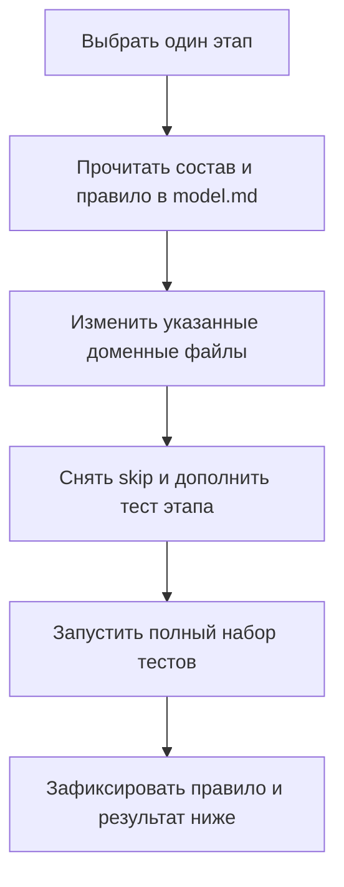

# Карта переноса модели в код

Этот документ превращает итоговую схему из `model.md` в шесть малых изменений
исходного кода. После завершения каждого этапа строка журнала дополняется
ссылкой на изменённый тест и кратким результатом запуска. Следующий этап не
начинается, пока проверки предыдущего остаются пропущенными или красными.



| Этап | Реализовать в домене | Проверить в тесте | Зафиксировать в журнале |
|---|---|---|---|
| 1 | `OrderId`, `OrderLineId`, `BuyerId`, `Sku`, `Currency`, `Quantity`, `Money`, `ShippingAddress`, `OrderLine`, `OrderLineSnapshot`, `Order` и `OrderStatus` | валюта, пустой заказ, адрес, размещение, изменение строки по идентификатору, неизменяемость после `place` | правило полного заказа и список новых типов |
| 2 | `SellerId`, поле продавца в строке и в `Order`, проверку в добавлении строки | отказ второй строки другого продавца без изменения заказа и повторного `OrderLineId` | правило одного продавца и новую сигнатуру строки |
| 3 | `LineKind`, платные и подарочные строки, `add_paid_line`, `add_gift_line` | нулевая цена подарка, платная часть для `place`, снимок строки | две команды и уточнение размещения |
| 4 | `StockItemId`, `WarehouseId`, `StockBalance`, `StockItem`, `receive`, `write_off` | приход, списание, запрет отрицательного остатка | правило физического остатка |
| 5 | `ReservationId`, `OrderId` в резерве, `StockReservation`, `ReservationSummary`, `reserve`, `release_reservation` | доступный остаток, предел резерва, освобождение без удаления | правило активных резервов |
| 6 | `ReservationDeadline`, `ReservationStatus`, `expire_reservations` | истечение в срок, будущий и освобождённый резервы | правило времени и итоговую формулу доступности |

## Рабочая запись этапа

После каждого завершённого этапа заполняется один блок. Формулировка правила
должна быть предметной и проверяемой: например, «активные резервы не превышают
физический остаток», а не «резервирование работает».

```text
Этап:
Изменённые файлы:
Добавленные типы и методы:
Правило, которое защищает корень:
Успешный сценарий:
Негативный сценарий и ожидаемая доменная ошибка:
Сохраняемые проверки:
Результат запуска unittest:
```

## Порядок изменения файлов

На этапах 1–3 сначала меняются `identifiers.py`, `values.py` и `order.py`, затем
активируются `test_order_baseline.py`, `test_order_seller.py` или
`test_order_gifts.py`. На этапах 4–6 сначала меняются типы и `stock_item.py`,
затем активируются `test_stock_baseline.py`, `test_stock_reservations.py` или
`test_stock_expiration.py`. `application.py` и `test_demo.py` становятся
окончательными после этапа 6, когда существуют обе границы и команда `reserve`.

Ни один этап не переносит правило в `application.py`. Прикладной сценарий
создаёт объекты и вызывает команды, но не сравнивает валюты, продавцов, остатки
или статусы вместо корней агрегатов.
